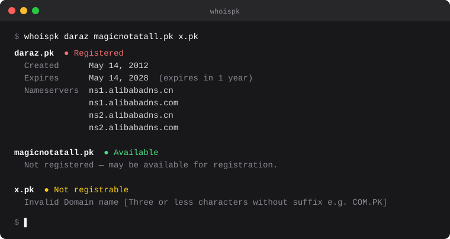

<div align="center">

# whoispk

**Check whether a `.pk` domain is taken, from your terminal or from Node.js.**

[](https://www.npmjs.com/package/whoispk)
[](https://www.npmjs.com/package/whoispk)
[](https://github.com/abbassiddiqi/whoispk/actions/workflows/ci.yml)
[](package.json)
[](package.json)
[](LICENSE)



</div>

`.pk` domains don't have a public WHOIS server, so the usual `whois` command can't look them up. whoispk asks PKNIC, the `.pk` registry, and gives you a clear answer: **registered**, **available**, or **not registrable**. It also shows the creation date, expiry date and nameservers.

## Quick start

No install needed:

```sh
npx whoispk yourbrand
```

`.pk` is added for you. `yourbrand`, `yourbrand.pk` and `https://www.yourbrand.pk/` all look up the same domain, and `.com.pk`, `.org.pk` and the other second-level names work too.

To have the `whoispk` command always available:

```sh
npm install -g whoispk
```

## Features

- **Clear answers.** Each domain is registered, available, or not registrable. For a name PKNIC rejects, you get its reason.
- **Many domains at once.** Pass several names, or pipe in a list. Lookups run in parallel and print in your order.
- **Made for scripts.** `--json` output, exit codes you can rely on, and no spinner in piped output.
- **Also a library.** A promise-based API with TypeScript types, timeouts, retries and cancelling.
- **Small.** No dependencies, about 10 kB installed. It uses Node's built-in `fetch`.
- **Watched for breakage.** Tests run every week against the real PKNIC site, so a change to their page gets noticed quickly.

## Recipes

**Check a shortlist of name ideas**, one per line (`#` starts a comment):

```sh
whoispk --json < ideas.txt | jq -r '.[] | select(.available) | .domain'
```

**Use it in a shell script:**

```sh
if whoispk --json chaiwala | jq -e '.available' > /dev/null; then
  echo "chaiwala.pk is free. Register it!"
fi
```

**Warn before your domains expire:**

```js
import { lookup } from 'whoispk';

for (const name of ['mybrand.pk', 'mybrand.com.pk']) {
  const r = await lookup(name);
  if (!r.registered) continue;

  const days = Math.round((Date.parse(r.expireDate) - Date.now()) / 86_400_000);
  if (days < 30) console.warn(`${r.domain} expires in ${days} days (${r.expireDate})`);
}
```

## CLI

```
whoispk [options] <domain...>

  -j, --json             Print results as JSON
  -t, --timeout <ms>     Per-request timeout (default: 15000)
  -c, --concurrency <n>  Parallel lookups (default: 3)
      --no-color         Disable colours (NO_COLOR is respected too)
```

The exit code is `0` when every lookup finished, `1` when any failed (e.g. PKNIC couldn't be reached), and `2` for bad usage.

See the **[CLI reference](docs/cli.md)** for the JSON format, stdin input and more.

## Library

```sh
npm install whoispk
```

```js
import { lookup } from 'whoispk';   // or: const { lookup } = require('whoispk');

const result = await lookup('daraz.pk');
```

```js
{
  domain: 'daraz.pk',
  status: 'registered',        // 'registered' | 'available' | 'invalid'
  registered: true,
  available: false,
  createDate: '2012-05-14',    // YYYY-MM-DD, or null
  expireDate: '2028-05-14',    // YYYY-MM-DD, or null
  nameservers: ['ns1.alibabadns.cn', 'ns1.alibabadns.com', 'ns2.alibabadns.cn', 'ns2.alibabadns.com'],
  reasons: [],                 // PKNIC's reasons, when status is 'invalid'
  fields: { 'Domain Name': 'daraz.pk', 'Create Date': 'May 14, 2012', 'Expire Date': 'May 14, 2028' }
}
```

Options include `timeout`, `retries`, `signal` and `fetch`. Failures reject with a `WhoisPkError` that has a `code`, such as `TIMEOUT` or `NETWORK_ERROR`. See the **[API reference](docs/api.md)** for all of it.

## FAQ

<details>
<summary><b>Why isn't the owner's name or contact shown?</b></summary>

PKNIC stopped publishing registrant, address and contact details because of GDPR and ICANN WHOIS policy. Only the dates and nameservers are public now. If you own the domain, you can see the full record by logging in to your PKNIC account.
</details>

<details>
<summary><b>Does "available" mean I can definitely register it?</b></summary>

Not quite. It means PKNIC has no record of the domain. PKNIC only checks whether the name is allowed, for example that it isn't reserved or blocked, when you actually register it. Names it rejects straight away, such as ones that are too short, show up as **not registrable**.
</details>

<details>
<summary><b>How do I register a domain I found?</b></summary>

Through [PKNIC](https://pknic.net.pk) or one of its registrars. whoispk only looks domains up.
</details>

<details>
<summary><b>It says <code>PARSE_ERROR</code>. What now?</b></summary>

PKNIC has probably changed its lookup page. Please [open an issue](https://github.com/abbassiddiqi/whoispk/issues). [How it works](docs/how-it-works.md) explains the parser, if you'd like to send a fix.
</details>

<details>
<summary><b>Is there a rate limit?</b></summary>

PKNIC doesn't publish one, but please be considerate. The CLI runs at most 3 lookups at a time by default, and retries only once, after a pause. Avoid checking thousands of names in a tight loop.
</details>

<details>
<summary><b>I'm upgrading from 1.x.</b></summary>

Version 2 needs Node.js 20.19 or later. The callback API is gone; use the promise. Dates are now `YYYY-MM-DD`. See the [changelog](CHANGELOG.md).
</details>

## Documentation

| Guide | What's in it |
| --- | --- |
| [CLI reference](docs/cli.md) | Every option, stdin input, JSON output, exit codes, `jq` recipes |
| [API reference](docs/api.md) | `lookup`, `parse`, `normalizeDomain`, result fields, errors |
| [How it works](docs/how-it-works.md) | How PKNIC's page is read, and what to do when it changes |
| [Changelog](CHANGELOG.md) | What changed in each release |
| [Releasing](docs/releasing.md) | How maintainers publish a new version to npm |

## Contributing

Bug reports and pull requests are welcome. [CONTRIBUTING.md](CONTRIBUTING.md) covers setup, tests and guidelines.

whoispk started in 2017. You can read about the original version in [this Medium post](https://medium.com/@abbassiddiqi/whoispk-command-line-tool-5ea275926688).

## License

[MIT](LICENSE) © Abbas Siddiqi

whoispk isn't affiliated with or endorsed by PKNIC. Results come from PKNIC's public lookup page and may change without notice.
